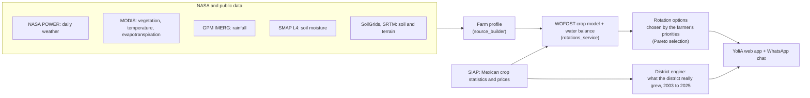

# YoliA: which crops should I plant next? (NASA Space Apps, Gradient Descent Farmers)

**YoliA helps a Mexican farmer choose a crop rotation using NASA satellite data and a crop-growth model, and explains the answer in plain Spanish (or English), on the web and in a WhatsApp-style chat.**

|  |  |
|---|---|
| **Live demo** | https://yoliaa.online (nothing to install; Spanish first, English with the toggle in the top bar) |
| **Code** | https://github.com/NASA-Gradient-Descent-Farmers/GradientDescentFarmers |
| **Try it in 2 minutes** | [How to see it](#try-it-in-2-minutes) |

---

## The problem

Smallholder farmers in northern and central Mexico decide every season what to plant, with little access to tools that combine
weather, soil, water and prices. A wrong choice costs a season. Satellite data exists for every field on Earth, but it is not
usable by a farmer as raw data.

## What YoliA does

A farmer marks their field, says how much land they have, whether they irrigate or depend on rain, and what matters most to them
(earn more, **use water well**, or look after the soil). YoliA answers **"what should I plant?"** with:

- **A rotation plan, step by step** (for example *sorghum → chickpea → fallow*) with the months of each crop.
- **Three figures that matter:** gross income per hectare (with its range over the price years), the water it needs, and how well
  it fits what the farmer said matters most.
- **An honest status** on every option: it is an exploratory experiment, never an approved plan, and the risky ones say so.
- **A second opinion from history:** what has actually worked in the farmer's own district over 20+ years of official statistics.

The same answers are available as a **chat** (the WhatsApp-style assistant at `/demo/whatsapp`, in Spanish and English), because
a farmer's phone is more likely to have WhatsApp than a planning app.

Three places are covered, chosen because they have different water and crop realities:

| Place | Plan YoliA suggests (irrigated, highest-fit option) | Gross income, whole plan (P10 to P90) | Irrigation applied |
|---|---|---|---|
| Sinaloa | maize → chickpea → maize | 144,511 MXN/ha (140,039 to 173,709) | 12,082 m³/ha |
| Sonora | maize → chickpea → fallow | 111,620 MXN/ha (105,863 to 128,112) | 9,329 m³/ha |
| Guanajuato | sorghum → chickpea → fallow | 84,706 MXN/ha (81,652 to 103,920) | 6,499 m³/ha |

*Gross income per hectare over the whole plan, before seed, irrigation, labour and other costs: it is not profit. These are
exploratory scenarios (low confidence, not validated in the field); see [Limits](#what-this-is-not-honest-limits).*

## Try it in 2 minutes

1. Open **https://yoliaa.online** and press **Entrar a YoliA**. Create a test account (no password: it is a local
   simulation) as **Agricultor**.
2. Mark a field on the map (or pick Sonora, Sinaloa or Guanajuato), answer the five short questions, then ask
   **"What should I plant?"**. You get the plan card above, then the district-history comparison.
3. Switch **English** in the top bar: the whole interface, the questions and the answers change language.
4. Press the **Probar por WhatsApp** (*Try it on WhatsApp*) button at the bottom right of the home page for the chat version: pick a place, ask *what should I plant*, then tap
   *See the crop model rotations* for the model's full numbers.
5. Choose **Técnico** in the account menu for the technical view: the model's numbers, evidence and the parcel tools.

## How it works



1. **Farm profile** (`gradientdescentfarmers/source_builder/`). For a location it downloads, cleans and quality-checks NASA and
   public data, and records provenance and SHA-256 hashes so every number can be traced to its source.
2. **Crop model** (`gradientdescentfarmers/rotations_service/`). The **WOFOST** crop simulator (PCSE) is run on the 2024 to 2025
   weather for candidate rotations, with a continuous water balance. Regional **SIAP** prices turn yields into gross income
   scenarios. A **Pareto selection** picks, per water regime, the options that best fit the farmer's priorities, and labels
   which ones stand out in income, water or soil.
3. **District engine** (`gradientdescentfarmers/model_builder/rotations/`). A second, independent tool compares the farmer's current
   rotation with alternatives built from what their district actually grows (SIAP 2003 to 2025), using NASA climate and FAO-56
   water balances. It states the evidence level, benefits, risks and questions to ask a technician.
4. **The app** (`frontend/`). A static React app that reads the precomputed results (committed in `frontend/public/data/`), so
   the demo works with no backend, no database and no API key.
5. **Optional language model.** If the site's server has a key, Claude phrases the chat summaries **only from the two tools'
   results**, and the figures it writes are checked against them; without a key, fixed written templates are used.
   The model never invents a number.

### NASA data used

| Source | What YoliA takes from it |
|---|---|
| **NASA POWER** | Daily temperature, rain, solar radiation, humidity and wind: the weather that drives the crop model |
| **MODIS MOD13Q1** | Vegetation greenness (NDVI/EVI), 16-day composites, with quality flags |
| **MODIS MOD11A2** | Land-surface temperature, day and night |
| **MODIS MOD16A2GF** | Evapotranspiration and potential evapotranspiration |
| **GPM IMERG V07** | Half-hourly rainfall, aggregated to days only when all 48 intervals are valid |
| **SMAP L4** | Surface and root-zone soil moisture |
| SoilGrids (ISRIC), SRTM | Soil properties by depth, elevation and slope |
| SIAP (Mexico), World Bank | Crop areas, yields, prices and national agricultural context |

## How much can you trust it?

We want a judge to be able to check, not just believe.

- **The district engine was back-tested.** It was trained on 2003 to 2019 and tested on what districts produced in 2020 to 2025.
  On 127 alternative-versus-current comparisons it got the direction (earns more or less) right **91%** of the time, against
  **68%** for always guessing the most common outcome; it was right in every case where it claimed a gap of 5,000 MXN/ha/yr or
  more. It was wrong on 11 pairs, which are listed. Full report, including what it cannot check:
  [`resources/district_backtest/REPORT_2019.md`](resources/district_backtest/REPORT_2019.md).
- **Every figure traces to a file.** The numbers on screen are the ones in each run's `rotations.json`, shown to the peso; the
  model's own sentences are kept word for word under "see all the data". Tests check this (`frontend/src/farmer/ui/ZoneAnswer.test.tsx`).
- **Unknown stays unknown.** A missing value is shown as "no data", never as zero.
- **Tested.** The web app, the conversation engine and the WhatsApp webhook have automated tests, and every push runs them
  (GitHub Actions: `.github/workflows/`).

### What this is not (honest limits)

- **Not agronomic advice.** The rotation results are exploratory scenarios from a crop model run on two years of weather, with
  *low confidence* and *no local calibration*. They have not been validated in the field, and the app says so on every answer.
- **Income is gross, not profit.** It ignores seed, irrigation, labour and other costs.
- **Soil and pesticide indicators are heuristic proxies**, labelled as such.
- **The rain-only plans are weak in the two driest places** (the model flags a season with almost no harvest as *high risk*).
  We show that rather than hide it.
- **Accounts are simulated** (no password, no server): they only keep each person's answers on their own phone.
- **WhatsApp:** the chat runs in the browser. An optional Twilio WhatsApp Sandbox server (`server/`) answers with the same
  conversation engine, but there is no production WhatsApp number or cloud deployment.

## Run it yourself

**The web app and chat need only Node 22.12 or newer** (no Python, backend or key):

```bash
cd frontend
npm ci
npm run dev                      # http://localhost:5173
npm test && npm run lint && npm run build
```

The chat is at `http://localhost:5173/demo/whatsapp` (add `?lang=en` for English).

**The Python pipeline** (Python 3.10 or newer; the crop-model service uses 3.11 and extra dependencies):

```bash
python3 -m pip install -r requirements.txt
python3 -m unittest discover -s tests -v
```

Rebuilding the model results needs NASA Earthdata credentials and Google Cloud access; the results the app shows are already
committed. See the module READMEs below.

**The optional WhatsApp webhook** (`server/`): needs a Twilio account and keeps its credentials in a git-ignored `.env`;
see [server/README.md](server/README.md).

## Repository map

```text
frontend/                     YoliA web app and chat (React + TypeScript + Vite), deployed to Netlify
  public/data/                precomputed results the app reads (rotations, environment, district, English text)
server/                       optional Twilio WhatsApp Sandbox webhook (shares the chat engine with the web app)
gradientdescentfarmers/
  source_builder/             NASA and public data -> verified farm profile
  rotations_service/          WOFOST crop model + SIAP economics -> rotation options
  model_builder/rotations/    district engine (SIAP 2003-2025) and its back-test
  optimizer_builder/          optimizer contract
  app.py                      configuration and integration order
resources/                    configurations, the district panel and the back-test report
tests/                        Python tests
```

More detail: [web app](frontend/README.md) ·
[farm profile builder](gradientdescentfarmers/source_builder/README.md) ·
[rotation service](gradientdescentfarmers/rotations_service/README.md) ·
[WhatsApp server](server/README.md) · [data notes](data/README.md).

## For developers

The package has three contracts (`SourceBuilder`, `ModelBuilder`, `OptimizerBuilder`) assembled by `Pipeline`:

```python
from gradientdescentfarmers.app import Pipeline, PipelineConfig

config = PipelineConfig.from_file("resources/application.conf")
components = Pipeline(MySource(), MyModel(), MyOptimizer()).build(config)
```

The shared configuration has the sections `source`, `model` and `optimizer`; personal overrides go in
`resources/*.local.conf`, which Git ignores. The package version is changed **only** in
`gradientdescentfarmers/version.py`. Create your branch from `main`, keep data, weights and local configuration out of Git, and
merge the latest `main` and run the tests before opening a pull request.
