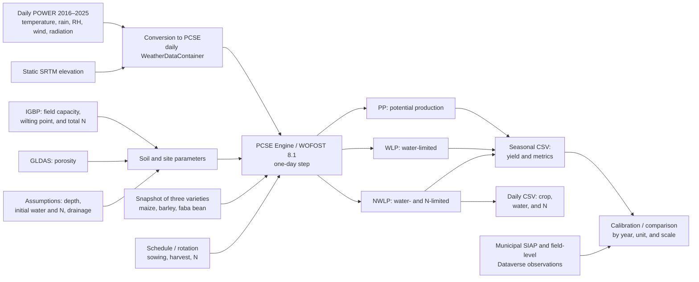

# WOFOST 8.1 in Python: inputs, production levels, outputs, and calibration for Texcoco

The reference documentation is the [PCSE reference guide](https://pcse.readthedocs.io/en/stable/reference_guide.html), its [list of models](https://pcse.readthedocs.io/en/stable/available_models.html), and [Wageningen's WOFOST description](https://www.wur.nl/en/research/products-services/wofost-world-food-studies).

## Data flow

PCSE requires a daily weather provider; crop, soil, and site parameters; a management schedule (`AgroManager`); and a model configuration. The engine integrates states in **one-day** steps. Daily and end-of-crop outputs depend on each configuration's `OUTPUT_VARS` and `SUMMARY_OUTPUT_VARS`, rather than a fixed set of three numbers. [PCSE engine and configuration](https://pcse.readthedocs.io/en/stable/reference_guide.html#the-engine).

## Are these PS1, PS2, and PS3?

**Those are neither the names nor the three results of the PCSE API.** Wageningen conceptually distinguishes *potential*, *limited*, and *actual/reduced* production. The WOFOST 8.1 variant used in this repository runs three specific levels:

| Local output | PCSE class | Correct interpretation |
|---|---|---|
| `yield_potential_t_ha` | `Wofost81_PP` | Dry-matter ceiling under the selected weather, variety, and date, assuming no water or nutrient limitations. It can serve as a theoretical ceiling under ideal irrigation, but **does not calculate an irrigation schedule**. |
| `yield_water_t_ha` | `Wofost81_WLP_CWB` | Production limited by water in the classic water balance, with nonlimiting N. This project models rainfed conditions without irrigation events. PCSE **can** accept `irrigate` events to test water management if dates, depths, and efficiency are added. |
| `yield_water_n_t_ha` | `Wofost81_NWLP_CWB_CNB` + local cap | Production limited by water and N, with assumed fertilization and mineralization. The CSV also applies a local cap based on minimum grain N content. |

`PP`, `WLP`, and `NWLP` are *production levels*, not `PS1`, `PS2`, and `PS3`. Actual/reduced production due to weeds, pests, diseases, salinity, or contaminants is a **conceptual** level; WOFOST/PCSE here does not simulate pesticide effectiveness, dosage, or timing. Recording pesticide applications in Dataverse does not create a “PS3” result. See [PCSE models](https://pcse.readthedocs.io/en/stable/available_models.html), [WOFOST levels](https://www.wur.nl/en/research/products-services/wofost-world-food-studies), and [PCSE irrigation events](https://pcse.readthedocs.io/en/stable/reference_guide.html#the-agromanager).

## Inputs and units

| PCSE input | Available source | File unit → PCSE unit | Time scale and status |
|---|---|---|---|
| `DAY`, `TMIN`, `TMAX`, `TEMP` | `nasa_power_texcoco_2016_2025.csv`: `date`, `power_t2m_min/max`, `power_t2m` | date, °C → date, °C | Daily, 2016–2025, POWER grid, not a field sensor. The daily API uses LST by default for this download. |
| `RAIN` | POWER `power_prectotcorr` | mm/day → cm/day, divide by 10 | Daily, 2016–2025. GPM could be an alternative if downloaded and harmonized; no local GPM CSV is currently available. |
| `IRRAD` | POWER `power_allsky_sfc_sw_dwn`, `AG` community | MJ/m²/day → J/m²/day, multiply by 10⁶ | Daily, 2016–2025. Do not confuse this with kWh/m²/day from other POWER communities. |
| `WIND` | POWER `power_ws2m` | m/s → m/s | Daily, 2016–2025, wind at 2 m. |
| `VAP` | POWER `power_rh2m` + mean temperature | % + °C → hPa | Daily; **derived** from relative humidity, not measured vapor pressure at the field. PCSE's standard POWER provider uses dew point and may yield a different result. |
| `E0`, `ES0`, `ET0` | PCSE `reference_ET`, using radiation, VAP, wind, temperature, latitude, and elevation | internally calculated mm/day → cm/day | **Calculated** daily; not ET observed by ECOSTRESS. |
| `LAT`, `LON`, `ELEV` | Reference point 19.53, −98.85; SRTM `srtm_elevation_m` | degrees, m → degrees, m | Fixed site; SRTM is static. SRTM slope is not used in this classic water balance. |
| Crop/variety | `wofost_crop_parameters.json` | PCSE parameter tables with their own units | Constants by variety, selected each season. |
| Schedule and rotation | `CROPS`, `ROTATIONS`, `season_agromanagement` | dates; N in kg N/ha; efficiency 0–1 | One season per crop and year; discrete applications. The rainfall-onset rule is specific to this project. |
| Soil and initial state | IGBP-DIS, GLDAS, and local assumptions | See the following table | Static site parameters plus the state at the start of each season; **not** a measurement from each field. |

The [PCSE weather container](https://pcse.readthedocs.io/en/stable/code.html) also expects `RAIN`, `E0`, `ES0`, and `ET0` in cm/day. NASA documents [daily POWER energy units](https://power.larc.nasa.gov/docs/methodology/data/sources_hydrology/) and the [daily API's default LST](https://power.larc.nasa.gov/docs/services/api/temporal/daily/). The `source_status.csv` list confirms that POWER, IGBP, GLDAS, and SRTM are available locally; SMAP, GPM, ECOSTRESS, MODIS, Landsat, and GRACE have error status and **do not drive this run**. SMAP, ECOSTRESS, and NDVI could be used to *compare* moisture, ET, and vegetation. Incorporating them into model states would require an explicit assimilation procedure. GRACE is regional and does not provide a field's available water. SIAP and Dataverse are used to compare or calibrate yields, not as daily forcing data.

## Soil: available values, assumptions, and data requested from the user

The local workflow uses the **classic, one-layer** water balance. `local_soil()` starts from `DummySoilDataProvider` and replaces three regional properties:

| PCSE parameter | Meaning and unit | Current value/source | If known for the field |
|---|---|---|---|
| `SMFCF` | Soil moisture at field capacity, m³/m³ | ≈0.373, IGBP 372.94 mm over 0–100 cm / 1000 mm | Replace with a retention measurement; high priority. |
| `SMW` | Soil moisture at wilting point, m³/m³ | ≈0.137, IGBP 137.34 mm/100 cm / 1000 mm | Replace with a measurement; high priority. |
| `SM0` | Porosity/saturation, m³/m³ | ≈0.437, GLDAS | Replace with measured porosity or bulk density and particle fractions; high priority. |
| `RDMSOL` | Rootable soil depth, cm | 100 cm, **assumed** | Measure effective depth where rock or a compacted layer exists; high priority. |
| `CRAIRC` | Critical air fraction for waterlogging, m³/m³ | 0.06, `DummySoilDataProvider` value | Optional for running; relevant where waterlogging occurs. |
| `SOPE`, `KSUB` | Maximum percolation in the root zone and subsoil, cm/day | 10 and 10, default values | Optional for running; measure or calibrate for credible runoff and drainage. |
| `K0` | Saturated conductivity, cm/day | 10, default provider value | Does not drive the current classic balance; useful if the soil module changes. |
| `WAV`, `SMLIM` | Initial available water, cm, and initial moisture limit, m³/m³ | 5 cm and 0.4 at the start of the sequence; **modeled** states are then carried forward | Profile moisture near sowing would improve the simulation; SMAP does not replace a field measurement. |
| `NAVAILI` | Initial available mineral N, kg N/ha | 10 kg N/ha initially; modeled N is then carried forward | Measure profile nitrate and ammonium; high priority when assessing fertilization. |
| `NSOILBASE`, `NSOILBASE_FR` | Base mineralizable N, kg N/ha, and daily fraction | IGBP total N ≈12,709 kg/ha × assumed fraction 0.005 ≈63.5 kg N/ha per season, released over 150 days | Total N **is not** mineral N; measured carbon, mineralization, and residues would improve the assumption. |

`CO2` is also required by the WOFOST 8.1 site provider. The code approximates it as `380 + 2.2 × (year − 2005)` ppm. The provider requires `WAV`, `NAVAILI`, and `CO2`, but the **user does not have to enter them to run the model**: the code currently supplies assumptions. See [PCSE site parameters](https://pcse.readthedocs.io/en/stable/code.html) and the [classic water balance](https://pcse.readthedocs.io/en/stable/_modules/pcse/soil/classic_waterbalance.html).

For a **new field**, the interface should request at least its location or municipality, crop/variety, sowing date or rule, crop history, and rainfed/irrigated status. Simulating irrigation requires **dates, water depth in mm per event, and efficiency**; PCSE receives the depth in cm. The Texcoco Dataverse files contain 15 irrigation events, but **none of the 15 records has a usable numerical water depth**. For fertilization, request date, product, grade, and dose to derive kg N/ha. Some of this exists in Dataverse, but coverage is incomplete and the current run retains an assumed schedule.

Dataverse soil records have coordinates in 44/44 entries and texture, erosion category, slope, and previous residue cover in 32/44. These can guide questions to the farmer, but **texture class alone does not determine** `SMFCF`, `SMW`, `SM0`, or initial mineral N. There are no repeated field-level measurements of organic matter, infiltration, salinity, conductivity, effective depth, or mineral N. Such measurements are not essential to **run** PCSE with assumptions, but they are needed to interpret water, N, erosion, or rotations as farm-specific results. Erosion and organic matter **are not validated outputs of the current classic model**.

## Crop catalog

The local snapshot supports only these three crops and varieties:

| Local key | WOFOST 8.1 crop and variety | Earliest possible sowing | Base N plan | Minimum grain/seed N for the local cap |
|---|---|---|---:|---:|
| `maize` | Grain maize · `Grain_maize_202` | May 15 | 160 kg N/ha | 1.0% of dry matter |
| `barley` | Barley · `Spring_barley_301` | July 1 | 60 kg N/ha | 1.2% of dry matter |
| `fababean` | Faba bean · `Faba_bean_801` | June 15 | 40 kg N/ha | 3.5% of dry matter |

These are schedules and doses from the code, not observed inputs from each farm. Maize can be grown continuously or before/after barley and faba bean; `ROTATIONS` also includes a three-crop sequence. The maize dose was taken as a scenario from a local trial; the barley and faba-bean doses are project assumptions.

The [`crops.yaml` catalog from the `wofost81` branch](https://raw.githubusercontent.com/ajwdewit/WOFOST_crop_parameters/wofost81/crops.yaml) listed **20 active crops** when this documentation was prepared: `barley`, `cassava`, `chickpea`, `cotton`, `cowpea`, `fababean`, `groundnut`, `maize`, `mungbean`, `pigeonpea`, `potato`, `rapeseed`, `rice`, `soybean`, `sugarbeet`, `sunflower`, `sweetpotato`, `tobacco`, `wheat`, and `seed_onion`. `millet`, `sorghum`, and `sugarcane` are commented out in that file and are not counted as active. The remote catalog may change; the versioned local snapshot retains only the three varieties above. `BEAN` in Dataverse does not automatically identify faba bean, and `TRITICALE` is not barley.

## Outputs for maize, barley, and faba bean

**All three species produce the same column schema**; their variety, schedule, N plan, and sequence differ. `TWSO` is **storage-organ** dry matter: maize/barley grain or faba-bean seed, not fresh forage or commercial yield adjusted for moisture. PCSE calculates other internal variables, but the exported list is fixed in [`texcoco_iteration1.py`](texcoco_iteration1.py). The following tables list **every column** in `seasons_{baseline,calibrated}.csv` and `daily_{baseline,calibrated}.csv`.

### One row per crop × year × rotation phase

| Columns in `seasons_*.csv` | Unit | Origin/interpretation |
|---|---|---|
| `rotation`, `phase`, `year`, `crop`, `previous_crop` | text; index; year; text; text | Scenario and phase identifiers; not measurements. |
| `sowing`, `maturity`, `harvest` | ISO date | Selected sowing date; simulated maturity and end date. |
| `n_fertilizer_kg_ha` | kg N/ha per season | Assumed plan in `CROPS` multiplied by `n_scale`. |
| `soil_water_at_start_mm` | mm water over 0–100 cm | Initial/modeled state, converted from cm to mm. |
| `mineral_n_at_start_kg_ha` | kg N/ha | Initial/modeled mineral N. |
| `yield_potential_t_ha`, `yield_water_t_ha` | t dry matter/ha | `TWSO / 1000` in PP and WLP. |
| `yield_water_n_wofost_t_ha` | t dry matter/ha | `TWSO / 1000` in NWLP **before** the local cap. |
| `yield_water_n_t_ha` | t dry matter/ha | NWLP after the local cap `min(TWSO, grain_N / minimum_concentration)`; not a purely native output. |
| `frost_ended` | Boolean | Whether an external project rule ended the crop at Tmin ≤ 0 °C. |
| `n_uptake_kg_ha`, `grain_n_kg_ha` | kg N/ha | Total uptake and simulated storage-organ N. |
| `water_stress_days`, `longest_dry_spell_days` | days per season | Days with `RFTRA < 0.5` and consecutive days with rain < 1 mm/day; project rules. |
| `rain_season_mm`, `rain_jul_aug_mm`, `rain_may_oct_mm` | mm per window | Accumulated POWER rainfall in the stated windows. |
| `water_pct_of_potential`, `water_n_pct_of_water` | % | Yield ratios capped at 100% in code. |
| `year_class` | `dry/normal/wet` category | May–October rainfall terciles among simulated years. |
| `rain_factor`, `n_scale` | dimensionless factor | Scenario multipliers. |
| `rain_months`, `sowing_mode` | text | Months affected by the rain factor and sowing rule. |
| `frost_tmin_offset` | °C | Scenario perturbation of Tmin. |
| `latitude`, `longitude` | decimal degrees | Grid/site point used in the simulation. |

### One row per day × crop × rotation phase

The local daily CSV exports only the **water- and N-limited** run. Values may be empty before emergence or after the crop ends; empty does not mean an observed zero.

| Columns in `daily_*.csv` | Unit | Meaning |
|---|---|---|
| `date`, `rotation`, `phase`, `year`, `crop` | date; text; index; year; text | Daily scenario identifiers. |
| `LAI` | m² leaf/m² soil | Leaf area index. |
| `SM` | m³ water/m³ soil | Simulated volumetric root-zone moisture in the classic balance. |
| `WWLOW` | cm water depth | Simulated total profile water, added to `OUTPUT_VARS` by the project. |
| `RFTRA` | fraction 0–1 | Actual/potential transpiration, a water-stress indicator. |
| `WLV`, `WRT`, `WST`, `WSO` | kg dry matter/ha | **Living** biomass in leaves, roots, stems, and storage organs. |
| `TRA`, `EVS` | cm/day | **Simulated** crop transpiration and soil evaporation. |
| `NamountLV`, `NamountST`, `NamountSO`, `NamountRT` | kg N/ha | N in leaves, stems, storage organs, and roots. |
| `NAVAIL` | kg N/ha | Simulated available mineral N in the soil. |

Depending on the production level, native PCSE configurations can also provide `DVS` (dimensionless stage), `TAGP` and total `TW*` weights (kg dry matter/ha), `RD` (cm), `TSUM`/`TSUME` (°C·day), `CTRAT`/`CEVST` (cumulative cm), `LAIMAX` (m²/m²), phenology dates `DOS`, `DOE`, `DOA`, `DOM`, `DOH`, `DOV`, and a final water balance (`WTRAT`, `EVST`, `EVWT`, `TSR`, `RAINT`, `TOTINF`, `TOTIRR`, `PERCT`, `LOSST`, all in cm). **Not all are exported** in the project's CSV files. `get_output()`, `get_summary_output()`, and `get_terminal_output()` expose them when requested by the configuration; changing `OUTPUT_VARS` or `SUMMARY_OUTPUT_VARS` changes the available list. The local configurations are PCSE 6.0.13's `Wofost81_PP.conf`, `Wofost81_WLP_CWB.conf`, and `Wofost81_NWLP_CWB_CNB.conf`. See the [engine guide](https://pcse.readthedocs.io/en/stable/reference_guide.html#engine-configuration-files).

In this implementation, WOFOST does not produce fresh-weight forage yield, erosion (t soil/ha), changes in organic matter, satellite NDVI, water outages, market value, profitability, pest incidence, pesticide effectiveness, or automatic recommendations. `crop_characteristics.csv` and Dataverse costs are **external decision layers**, not biophysical variables calculated by WOFOST.

## Calibration used here

1. **Define the observation for comparison.** The municipal exercise compares SIAP grain maize per sown area (t/ha) with simulated continuous maize in the same year. SIAP lacks field identity, sowing date, and grain moisture; WOFOST yields dry matter. This is an approximate comparison, not a validation of rotation. The Dataverse exercise uses only rainfed `MAIZE` + `GRAIN` + `TON` records with observed sowing dates, and it also lacks moisture data.
2. **Choose parameters to explore.** [`texcoco_iteration1.py`](texcoco_iteration1.py) tests 16 combinations of sowing rule (rainfall onset/fixed), thermal-time `TSUM1/TSUM2` scales (0.8/1.0), photosynthesis `AMAX_REF/AMAX_SLP/EFFTB` scales (0.5/0.7), and N dose (0.5/1.0).
3. **Simulate and score.** The year 2016 initializes states. Continuous-maize `TWSO / 1000` is calculated for each year from 2017 to 2021, and RMSE against SIAP is minimized. The selected candidate uses fixed sowing, `TSUM ×0.8`, photosynthesis `×0.5`, and fertilizer `×0.5`. Years 2022–2025 are reported as a retrospective check; they had already been examined in earlier work.
4. **Separate other evidence.** The three crops share output types, but that grid **did not calibrate barley or faba bean with field observations**. An earlier path in [`calibration.py`](calibration.py) explored crop-specific parameters and mineralization against SIAP 2006–2021, with limitations described in [`CALIBRATION_RESULTS.md`](CALIBRATION_RESULTS.md).
5. **Test outside the fit.** [`dataverse_replication.py`](dataverse_replication.py) reused the SIAP fit without refitting on field records. Across five rainfed maize records from 2018–2019 (three fields), RMSE was 3.11 t/ha for calibrated WOFOST, 6.84 t/ha for baseline WOFOST, and 1.54 t/ha for Ridge. Because SIAP 2017–2021 included 2018–2019 at the municipal scale, this comparison **is not a fully independent holdout**. The sample is small and fields repeat.

The photosynthesis factor is an aggregate parameter that may absorb errors in variety, soil, management, phenology, and unmodeled pests; it **does not show** the cause of the yield difference. Defensible field-level calibration requires multiple harvests; emergence, flowering, and maturity dates; commercial product moisture; quantified irrigation; actual N doses; and soil water and N measurements. Reserve new fields/years before fitting. A yield calibration also does not, by itself, validate benefits related to erosion, organic matter, or rotations.
