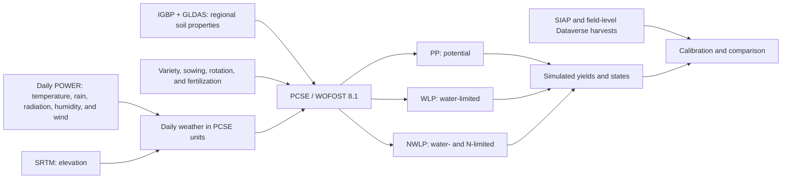

# WOFOST 8.1 in PCSE: inputs, production levels, outputs, and calibration for Texcoco

**The key correction:** PCSE does not have three outputs named PS1, PS2, and PS3. Our implementation runs three **production levels** (`PP`, `WLP`, `NWLP`), each of which can produce multiple daily and seasonal variables. The third is limited by **water and nitrogen**; it does not model pesticides. Wageningen describes production reduced by pests and diseases as a conceptual level, but notes that WOFOST does not simulate those factors.

References: [PCSE models](https://pcse.readthedocs.io/en/stable/available_models.html), [WOFOST description](https://www.wur.nl/en/research/products-services/wofost-world-food-studies), [PCSE reference guide](https://pcse.readthedocs.io/en/stable/reference_guide.html).

## Flow diagram

PCSE requires a daily weather provider; crop, soil, and site parameters; a management schedule (`AgroManager`); and a model configuration. The engine advances in **one-day** steps. Daily and end-of-crop outputs depend on `OUTPUT_VARS` and `SUMMARY_OUTPUT_VARS` in each configuration, rather than a fixed set of three numbers. [PCSE engine and configuration](https://pcse.readthedocs.io/en/stable/reference_guide.html#the-engine).

## Are these PS1, PS2, and PS3?

**Those are neither the names nor the three results of the PCSE API.** Wageningen conceptually distinguishes *potential*, *limited*, and *actual/reduced* production. The WOFOST 8.1 variant used in this repository runs these levels:

| Local output | PCSE class | Correct interpretation |
|---|---|---|
| `yield_potential_t_ha` | `Wofost81_PP` | Dry-matter ceiling under the selected weather, variety, and date, assuming no water or nutrient limitations. It can serve as a theoretical ceiling under ideal irrigation, but **does not calculate an irrigation schedule**. |
| `yield_water_t_ha` | `Wofost81_WLP_CWB` | Production limited by water in the classic water balance, with nonlimiting N. This project models rainfed conditions without irrigation events. PCSE **can** accept `irrigate` events to test water management if dates, amounts, and efficiency are added. |
| `yield_water_n_t_ha` | `Wofost81_NWLP_CWB_CNB` + local cap | Production limited by water and N, with assumed fertilization and mineralization. The CSV also applies a local cap based on minimum grain N content. |

`PP`, `WLP`, and `NWLP` are *production levels*, not `PS1`, `PS2`, and `PS3`. Actual/reduced production due to weeds, pests, diseases, salinity, or contaminants is a **conceptual** level; WOFOST/PCSE here does not simulate pesticide effectiveness, dosage, or timing. Recording pesticide applications in Dataverse does not create a “PS3” result.

References: [PCSE models](https://pcse.readthedocs.io/en/stable/available_models.html), [WOFOST production levels](https://www.wur.nl/en/research/products-services/wofost-world-food-studies), and [PCSE irrigation events](https://pcse.readthedocs.io/en/stable/reference_guide.html#the-agromanager).

## Available inputs and units

| PCSE input | Local source | File unit → PCSE unit | Time scale and status |
|---|---|---|---|
| `DAY`, `TMIN`, `TMAX`, `TEMP` | NASA POWER: `date`, `power_t2m_min/max`, `power_t2m` | date, °C → date, °C | Daily, 2016–2025, POWER grid, not a field sensor. The daily API uses LST by default for this download. |
| `RAIN` | POWER `power_prectotcorr` | mm/day → cm/day, divide by 10 | Daily, 2016–2025. GPM could be an alternative if downloaded and harmonized; no local GPM CSV is currently available. |
| `IRRAD` | POWER `power_allsky_sfc_sw_dwn`, `AG` community | MJ/m²/day → J/m²/day, multiply by 10⁶ | Daily. Do not confuse this with kWh/m²/day from other POWER communities. |
| `WIND` | POWER `power_ws2m` | m/s → m/s | Daily wind at 2 m. |
| `VAP` | POWER `power_rh2m` + mean temperature | % + °C → hPa | Daily; **derived** from relative humidity, not measured vapor pressure at the field. PCSE's standard POWER provider uses dew point and may yield a different result. |
| `E0`, `ES0`, `ET0` | PCSE `reference_ET` calculation | mm/day → cm/day | **Calculated** daily; not ET observed by ECOSTRESS. |
| `LAT`, `LON`, `ELEV` | Point 19.53, −98.85; SRTM `srtm_elevation_m` | degrees, m → degrees, m | Fixed site; SRTM is static. SRTM slope is not used in this classic water balance. |
| Crop/variety | `wofost_crop_parameters.json` | PCSE parameters with their own units | Constants by variety, selected each season. |
| Schedule and rotation | `CROPS`, `ROTATIONS`, `season_agromanagement` | dates; N in kg N/ha | One season per crop and year; discrete applications. |
| Soil and initial state | IGBP-DIS, GLDAS, and local assumptions | See soil section | Static site parameters plus a state at the start of each season; not measurements from each field. |

The [PCSE weather container](https://pcse.readthedocs.io/en/stable/code.html) expects `RAIN`, `E0`, `ES0`, and `ET0` in cm/day. NASA documents [daily POWER energy units](https://power.larc.nasa.gov/docs/methodology/data/sources_hydrology/) and the [daily API's default LST](https://power.larc.nasa.gov/docs/services/api/temporal/daily/).

POWER, IGBP, and GLDAS are **gridded products**, not field measurements. SMAP, GPM, ECOSTRESS, Landsat, MODIS, and GRACE have no usable CSV in the [source-status file](../data_texcoco/source_status.csv); they do not drive this run. SMAP, ECOSTRESS, and NDVI could be used to compare moisture, ET, and vegetation. Incorporating them into model states would require an explicit assimilation procedure. GRACE is regional and does not provide a field's available water. SIAP and Dataverse are used to compare or calibrate yields, not as daily forcing data.

## Soil: available values, assumptions, and requested data

The local workflow uses the **classic, one-layer** water balance. `local_soil()` starts from `DummySoilDataProvider` and replaces three regional properties:

| PCSE parameter | Meaning and unit | Current value/source | If known for the field |
|---|---|---|---|
| `SMFCF` | Soil moisture at field capacity, m³/m³ | ≈0.373, IGBP: 372.94 mm over 0–100 cm / 1000 mm | Replace with a retention measurement; high priority. |
| `SMW` | Soil moisture at wilting point, m³/m³ | ≈0.137, IGBP: 137.34 mm/100 cm / 1000 mm | Replace with a measurement; high priority. |
| `SM0` | Porosity/saturation, m³/m³ | ≈0.437, GLDAS | Replace with measured porosity or bulk density and particle fractions; high priority. |
| `RDMSOL` | Rootable soil depth, cm | 100 cm, assumed | Measure effective depth where rock or a compacted layer exists; high priority. |
| `CRAIRC` | Critical air fraction for waterlogging, m³/m³ | 0.06, default provider value | Optional for running the model; useful if waterlogging occurs. |
| `SOPE`, `KSUB` | Maximum percolation in the root zone and subsoil, cm/day | 10 and 10, default values | Optional for running; measure or calibrate to represent drainage. |
| `K0` | Saturated conductivity, cm/day | 10, default value; does not drive the current classic balance | Useful if the soil module changes. |
| `WAV`, `SMLIM` | Initial available water, cm, and initial moisture limit, m³/m³ | 5 cm and 0.4 initially; modeled states are then carried forward | Profile moisture near sowing would improve the simulation. |
| `NAVAILI` | Initial available mineral N, kg N/ha | 10 kg N/ha initially; modeled N is then carried forward | Measure profile nitrate and ammonium when assessing fertilization. |
| `NSOILBASE`, `NSOILBASE_FR` | Base mineralizable N, kg N/ha, and daily fraction | IGBP total N ≈12,709 kg/ha × assumed fraction 0.005 ≈63.5 kg N/ha per season, released over 150 days | Total N is not mineral N; measured organic matter and mineralization would improve the assumption. |

`CO2` is also required by the WOFOST 8.1 site provider. The code approximates it as `380 + 2.2 × (year − 2005)` ppm. The provider requires `WAV`, `NAVAILI`, and `CO2`, but the **user does not have to enter them to run the model**: the code currently supplies assumptions. See [PCSE site parameters](https://pcse.readthedocs.io/en/stable/code.html) and the [classic water balance](https://pcse.readthedocs.io/en/stable/_modules/pcse/soil/classic_waterbalance.html).

For a new field, the interface should request at least its location or municipality, crop/variety, sowing date or rule, crop history, and rainfed/irrigated status. Simulating irrigation requires **dates, water depth in mm per event, and efficiency**; PCSE receives the depth in cm. Dataverse has 15 irrigation-event records, but **none contains a usable numerical water depth**. For fertilization, request date, product, grade, and dose to derive kg N/ha. Current coverage is incomplete, and the run retains an assumed schedule.

Dataverse soil records have coordinates in 44/44 entries and texture, erosion category, slope, and previous residue cover in 32/44. These can guide questions to the farmer, but **texture class alone does not determine** `SMFCF`, `SMW`, `SM0`, or initial mineral N. There are no repeated field-level measurements of organic matter, infiltration, salinity, conductivity, effective depth, or mineral N. Such data are not essential to **run** PCSE with assumptions, but they are needed to interpret water, N, erosion, or rotations as farm-specific results. Erosion and organic matter are not validated outputs of the current classic model.

## Crop catalog

The local snapshot contains three crops and varieties:

| Local key | WOFOST 8.1 crop and variety | Earliest possible sowing | Base N plan | Minimum grain/seed N for the local cap |
|---|---|---|---:|---:|
| `maize` | Grain maize · `Grain_maize_202` | May 15 | 160 kg N/ha | 1.0% of dry matter |
| `barley` | Barley · `Spring_barley_301` | July 1 | 60 kg N/ha | 1.2% of dry matter |
| `fababean` | Faba bean · `Faba_bean_801` | June 15 | 40 kg N/ha | 3.5% of dry matter |

These are schedules and doses from the code, not observed inputs from each farm. Maize can be grown continuously or with barley/faba bean; a three-crop sequence also exists. The maize dose is a scenario based on a local trial; the barley and faba-bean doses are project assumptions.

The [WOFOST 8.1 `crops.yaml` catalog](https://raw.githubusercontent.com/ajwdewit/WOFOST_crop_parameters/wofost81/crops.yaml) listed **20 active crops** when this document was prepared: `barley`, `cassava`, `chickpea`, `cotton`, `cowpea`, `fababean`, `groundnut`, `maize`, `mungbean`, `pigeonpea`, `potato`, `rapeseed`, `rice`, `soybean`, `sugarbeet`, `sunflower`, `sweetpotato`, `tobacco`, `wheat`, and `seed_onion`. `millet`, `sorghum`, and `sugarcane` are commented out and are not counted as active. The remote catalog may change; the local snapshot retains the three varieties above. `BEAN` in Dataverse does not automatically identify faba bean, and `TRITICALE` is not barley.

## Outputs for maize, barley, and faba bean

**All three species use the same column schema**; the variety, schedule, N plan, and sequence differ. `TWSO` is **storage-organ** dry matter: maize/barley grain or faba-bean seed, not fresh forage or a commercial yield adjusted for moisture. The tables list every column in the local workflow's `seasons_{baseline,calibrated}.csv` and `daily_{baseline,calibrated}.csv`.

### One row per crop × year × rotation phase

| Seasonal columns | Unit | Origin/interpretation |
|---|---|---|
| `rotation`, `phase`, `year`, `crop`, `previous_crop` | text, index, year | Scenario and phase identifiers. |
| `sowing`, `maturity`, `harvest` | ISO date | Selected sowing date; simulated maturity and end date. |
| `n_fertilizer_kg_ha` | kg N/ha per season | Assumed plan multiplied by `n_scale`. |
| `soil_water_at_start_mm` | mm water over 0–100 cm | Initial/modeled state, converted from cm. |
| `mineral_n_at_start_kg_ha` | kg N/ha | Initial/modeled mineral N. |
| `yield_potential_t_ha`, `yield_water_t_ha` | t dry matter/ha | `TWSO / 1000` in PP and WLP. |
| `yield_water_n_wofost_t_ha` | t dry matter/ha | `TWSO / 1000` in NWLP before the local cap. |
| `yield_water_n_t_ha` | t dry matter/ha | NWLP after the local minimum N-concentration cap. |
| `frost_ended` | Boolean | Whether an external rule ended the crop at Tmin ≤ 0 °C. |
| `n_uptake_kg_ha`, `grain_n_kg_ha` | kg N/ha | Total uptake and simulated storage-organ N. |
| `water_stress_days`, `longest_dry_spell_days` | days/season | Days with `RFTRA < 0.5` and consecutive days with rain <1 mm/day; project rules. |
| `rain_season_mm`, `rain_jul_aug_mm`, `rain_may_oct_mm` | mm/window | Accumulated POWER rainfall in the stated windows. |
| `water_pct_of_potential`, `water_n_pct_of_water` | % | Yield ratios capped at 100% in code. |
| `year_class` | `dry/normal/wet` category | May–October rainfall terciles in the simulated years. |
| `rain_factor`, `n_scale` | dimensionless factor | Scenario multipliers. |
| `rain_months`, `sowing_mode` | text | Months with rainfall changes and sowing rule. |
| `frost_tmin_offset` | °C | Scenario perturbation of Tmin. |
| `latitude`, `longitude` | decimal degrees | Point used in the simulation. |

### One row per day × crop × rotation phase

The daily CSV exports only the water- and N-limited run. Empty values before emergence or after the crop ends do not mean an observed zero.

| Daily columns | Unit | Meaning |
|---|---|---|
| `date`, `rotation`, `phase`, `year`, `crop` | date, text, index, year | Daily simulation identifiers. |
| `LAI` | m² leaf/m² soil | Leaf area index. |
| `SM` | m³ water/m³ soil | Simulated volumetric moisture in the root zone. |
| `WWLOW` | cm water depth | Simulated total profile water. |
| `RFTRA` | fraction 0–1 | Actual/potential transpiration, a water-stress indicator. |
| `WLV`, `WRT`, `WST`, `WSO` | kg dry matter/ha | Living biomass in leaves, roots, stems, and storage organs. |
| `TRA`, `EVS` | cm/day | Simulated crop transpiration and soil evaporation. |
| `NamountLV`, `NamountST`, `NamountSO`, `NamountRT` | kg N/ha | N in leaves, stems, storage organs, and roots. |
| `NAVAIL` | kg N/ha | Simulated available mineral N in soil. |

Depending on the production level, native PCSE configurations can also produce `DVS` (dimensionless stage), `TAGP` and total `TW*` weights (kg dry matter/ha), `RD` (cm), `TSUM`/`TSUME` (°C·day), `CTRAT`/`CEVST` (cumulative cm), `LAIMAX` (m²/m²), phenology dates `DOS`, `DOE`, `DOA`, `DOM`, `DOH`, `DOV`, and a final water balance with `WTRAT`, `EVST`, `EVWT`, `TSR`, `RAINT`, `TOTINF`, `TOTIRR`, `PERCT`, and `LOSST` (cm). **Not all are exported** in the project's CSV files. `get_output()`, `get_summary_output()`, and `get_terminal_output()` depend on the variables requested in the configuration. [PCSE engine configuration guide](https://pcse.readthedocs.io/en/stable/reference_guide.html#engine-configuration-files).

In this implementation, WOFOST does not produce fresh-forage yield, erosion (t soil/ha), changes in organic matter, NDVI, water outages, market value, profitability, pest incidence, pesticide effectiveness, or automatic recommendations. `crop_characteristics.csv` and Dataverse costs are external decision layers, not biophysical variables calculated by the model.

## Calibration used here

1. **Define the observation for comparison.** The municipal exercise compares SIAP grain maize per sown area (t/ha) with simulated continuous maize in the same year. SIAP lacks field identity, sowing date, and grain moisture; WOFOST yields dry matter. This is an approximate comparison, not a validation of rotation. Dataverse uses only rainfed `MAIZE` + `GRAIN` + `TON` records with observed sowing dates.
2. **Choose parameters to test.** [`texcoco_iteration1.py`](texcoco_iteration1.py) tests 16 combinations of sowing rule (rainfall onset/fixed), `TSUM1/TSUM2` scales (0.8/1.0), photosynthesis parameters (`AMAX_REF`, `AMAX_SLP`, `EFFTB`, 0.5/0.7), and N dose (0.5/1.0).
3. **Simulate and score.** The year 2016 initializes states. Continuous-maize `TWSO / 1000` is calculated for each year from 2017 to 2021, and RMSE against SIAP is minimized. The selected candidate uses fixed sowing, thermal time ×0.8, photosynthesis ×0.5, and fertilizer ×0.5. Years 2022–2025 are reported as a retrospective check; they had already been examined in earlier work.
4. **Separate evidence by crop.** That grid did not calibrate barley or faba bean with field observations. [`calibration.py`](calibration.py) follows another path that explored crop-specific parameters and mineralization against SIAP 2006–2021, subject to the limitations in [`CALIBRATION_RESULTS.md`](CALIBRATION_RESULTS.md).
5. **Compare against fields without refitting.** [`dataverse_replication.py`](dataverse_replication.py) reused the SIAP fit. Across five rainfed maize records from 2018–2019 (three fields), RMSE was 3.11 t/ha for calibrated WOFOST, 6.84 for baseline WOFOST, and 1.54 for Ridge. The SIAP calibration had already included those years at the municipal scale, so this is not an independent validation.

The photosynthesis factor may absorb effects of variety, soil, management, phenology, and unmodeled pests; it does not show which caused the yield difference. Field-level calibration requires multiple harvests, phenology dates, commercial moisture, quantified irrigation, actual N doses, and soil water and N measurements. New years or fields should be reserved before fitting. Fitting yield also does not validate erosion, organic matter, or rotation effects.
